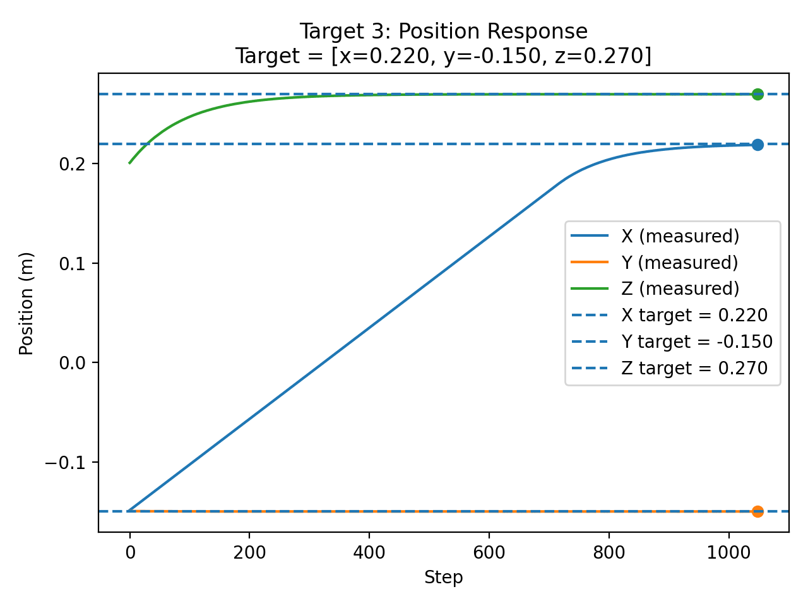
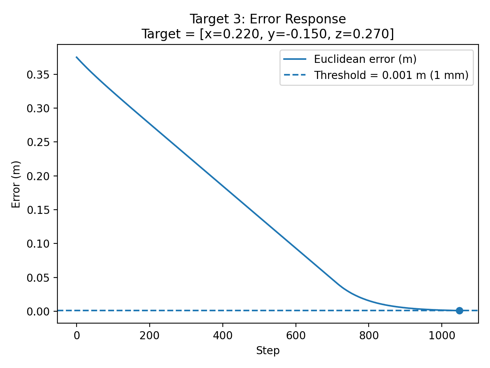

# Task 10 – PID Controller for Opentrons OT-2 (Simulation)

This project implements and evaluates a **3-axis PID controller** for the
Opentrons OT-2 robot in a PyBullet simulation environment.

The controller moves the pipette tip to target positions inside the measured
workspace with **sub-millimeter accuracy (< 1 mm)**, achieving the **maximum
performance tier** defined in the task requirements.

---

## 1. Overview

The goal of Task 10 is to design, implement, test, tune, and evaluate a
**traditional PID controller** for a robotic system.

This project demonstrates:
- Design and implementation of PID control
- Quantitative performance evaluation
- Parameter tuning to improve system behavior
- Clear visualizations of controller response
- Telemetry and GIF evidence of correct motion

Three independent PID controllers are used:
- X-axis controller
- Y-axis controller
- Z-axis controller

Each controller outputs **velocity commands** to move the pipette toward a
target position.

---

## 2. Project Structure

    task10_pid_controller/
    │
    ├── pid.py                          # PID controller class
    ├── pid_controller_demo.py          # Single-target demo + GIF with telemetry
    ├── pid_tuning_test.py              # Multi-target testing, tuning, plots
    ├── movement.gif                    # PID-controlled motion GIF
    │
    ├── target_1_position_response.png
    ├── target_1_error_response.png
    ├── target_2_position_response.png
    ├── target_2_error_response.png
    ├── target_3_position_response.png
    ├── target_3_error_response.png
    ├── target_4_position_response.png
    ├── target_4_error_response.png
    ├── target_5_position_response.png
    ├── target_5_error_response.png
    │
    ├── sim_class.py                    # OT-2 simulation engine (provided)
    ├── ot_2_simulation_v6.urdf         # OT-2 robot model
    └── README.md

---

## 3. Environment Setup

### Python / OS
- Python version: **3.10.x**
- Tested on: Windows 10 / Windows 11  
- Expected to work on Linux and macOS with Python 3.10

### Dependencies
Install into a virtual environment:

pip install pybullet numpy matplotlib imageio opencv-python

### Required Assets
This project uses the provided OT-2 simulation files:
- sim_class.py
- ot_2_simulation_v6.urdf
- required meshes and textures

---

## 4. PID Controller Equation

Each axis uses a standard PID controller to compute a velocity command:

    v = Kp · e + Ki · ∫e dt + Kd · de/dt

Where:
- `e` is the position error (target − current)
- `v` is the commanded velocity

To ensure stability and prevent large jumps, the velocity output is clamped:

    output_limit = ±0.3

---

## 5. Implementation Steps (Control Loop)

At each simulation step:

1. Read the current pipette position from the simulator
2. Compute per-axis position error (X, Y, Z)
3. Run three independent PID controllers
4. Clamp velocity outputs to ±0.3
5. Send velocity command to the simulator
6. Compute Euclidean positioning error
7. Stop when error < 0.001 m
8. Implementation detail: each control iteration performs a read step (0 velocity) then a command step because state is returned via sim.run(...)
---

## 6. Error Calculation

The positioning error is computed as the **Euclidean distance** between the
current pipette position and the target position:

    error = sqrt(
        (x_target - x_current)^2 +
        (y_target - y_current)^2 +
        (z_target - z_current)^2
    )

The controller stops when:

    error < 0.001 m

final positioning error < 1 mm ( < 0.001 m ).

---

## 7. Final PID Gains (After Tuning)

The same tuned gains are used for all three axes:

| Axis | Kp  | Ki  | Kd  | Velocity Clamp |
|------|-----|-----|-----|----------------|
| X    | 3.5 | 0.0 | 1.2 | ±0.3 |
| Y    | 3.5 | 0.0 | 1.2 | ±0.3 |
| Z    | 3.5 | 0.0 | 1.2 | ±0.3 |

### Why Ki = 0?

Integral control caused:
- Overshoot
- Slow settling
- Instability near the target

Removing the integral term resulted in:
- Faster convergence
- Smoother motion
- No steady-state error

---

## 8. PID Demo (Single Target)

Run:

    python pid_controller_demo.py

This script:
- Moves the pipette to a fixed target
- Displays telemetry (target, position, error)
- Stops when error < 1 mm
- Saves a GIF (movement.gif)
- This demo uses the final tuned gains (Kp=3.5, Ki=0.0, Kd=1.2) with ±0.3 velocity clamp.
---

## 9. PID Testing & Tuning (Multiple Targets)

Run:

    python pid_tuning_test.py

### Testing Method
- 5 fixed target positions inside the measured workspace
- Fixed targets ensure repeatability
- Avoid unreachable XYZ combinations
- Fresh PID controllers for each test
- Position and error logged at every step

### Fixed Test Targets

    [0.00,  0.00, 0.27]
    [-0.15, -0.15, 0.20]
    [0.22, -0.15, 0.27]
    [-0.15,  0.20, 0.20]
    [0.22,  0.20, 0.20]

---

## 10. Performance Metrics (Final Results)

    Targets tested: 5
    Successes (< 0.001 m): 5 / 5
    Min error:  0.000900 m
    Max error:  0.000995 m
    Mean error: 0.000931 m

All targets meet the **< 1 mm requirement**.

---

## 11. Controller Response Visualizations

One representative example (**Target 3**) is shown below.  
All plots for all targets are included in the repository.

### Target 3 – Position Response

- X, Y, Z converge smoothly to the target
- No oscillation observed

### Target 3 – Error Response

- Monotonic error decay
- Crosses the 1 mm threshold
- Stable final error

---

## 12. Error Analysis

From plots and logs:
- Error decreases smoothly without oscillation
- No overshoot after tuning
- Settling time varies due to OT-2 kinematics
- Final error consistently below **1 mm**

The derivative term (**Kd**) was critical for damping motion near the target.

---

## 13. Tuning Strategy Summary

1. Disable integral term (Ki = 0) to avoid windup
2. Increase proportional gain for responsiveness
3. Add derivative gain to damp overshoot
4. Validate gains across multiple targets

---

## 14. Libraries Used

- pybullet
- numpy
- matplotlib
- imageio
- time
- opencv-python

---

## 15. Reproducibility

To reproduce results:

1. Ensure all required simulation assets are present
2. Install dependencies
3. Run `pid_controller_demo.py` for single-target demo and GIF
4. Run `pid_tuning_test.py` to reproduce plots and metrics
5. Compare printed metrics with those reported above

---

## 16. Conclusion

A fully tuned **3-axis PID controller** was successfully implemented for the
Opentrons OT-2 simulation.

- Final accuracy: **≈ 0.0009 m**
- Stable and smooth convergence
- Meets the highest performance tier in the task specification

