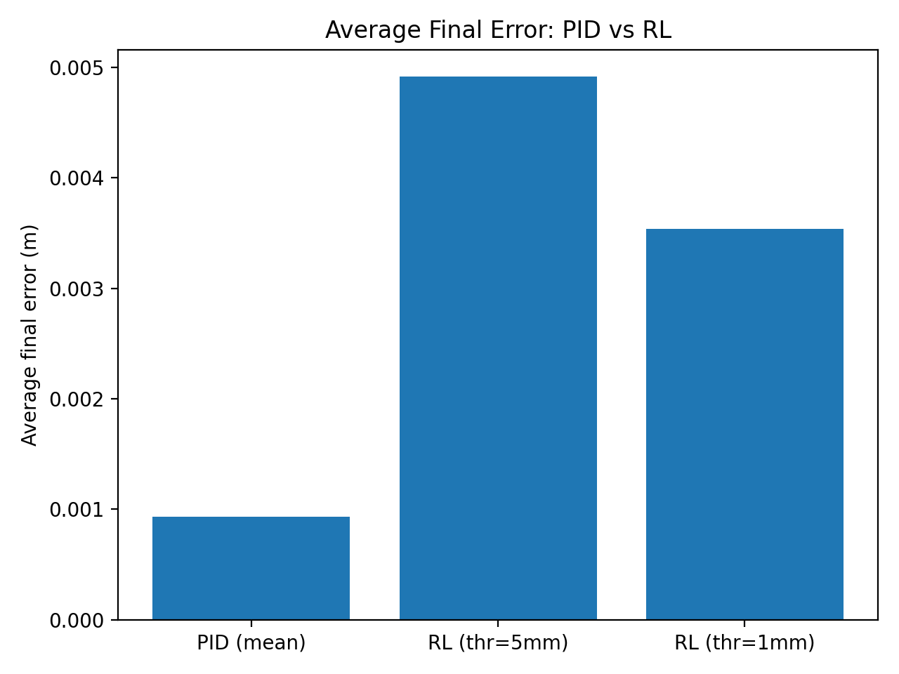
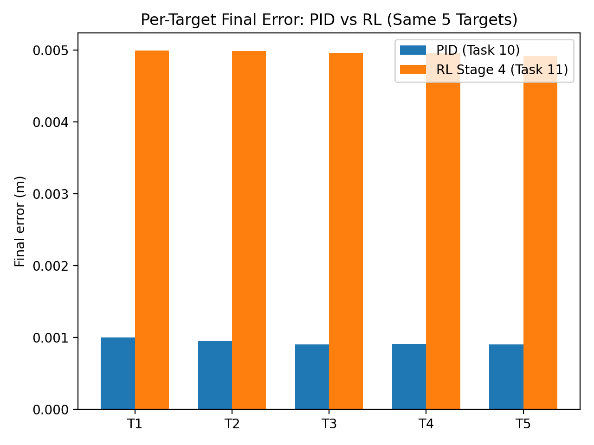

# Task 11 – Reinforcement Learning Controller (Opentrons OT-2 Simulation)

This task implements a **reinforcement learning (RL) controller** for the Opentrons OT-2 pipette using **Stable Baselines 3 (PPO)** and a custom **Gymnasium wrapper** around the provided PyBullet digital twin (Task 9 `sim_class.py`).

The final submission includes:
- A Gymnasium-compatible environment wrapper (action/observation/reward/termination)
- Random-action validation script (1000 steps)
- RL training script + saved best weights (Stage 4)
- RL testing/evaluation script (rubric bands and error metrics)
- GIF evidence of the trained RL agent reaching fixed targets
- Visualizations comparing RL performance with the Task 10 PID controller

---

## 1. Folder Structure (Current Repository Layout)

    4-rl-controller/
    │
    ├── Gif_demo/
    │   ├── Gif_demo.py
    │   └── rl_agent_demo.gif
    │
    ├── compare_pid_vs_rl/
    │   ├── compare_pid_vs_rl.py
    │   ├── comparison_avg_error.png
    │   ├── comparison_bands.png
    │   ├── comparison_per_target_error.png
    │   └── comparison_per_target_error.py
    │
    ├── envs/
    │   ├── ot2_gym_wrapper.py
    │   └── test_wrapper.py
    │
    ├── task09_robotics_environment/
    │   └── sim_class.py, URDFs, meshes/, textures/, ...
    │
    └── training/
        ├── RL_training_code.py
        ├── RL_testing_code.py
        └── ppo_ot2_finals4.zip

---

## 2. Environment Setup

### 2.1 Python / OS
- Python: **3.10.x**
- Tested on Windows 10/11
- Expected to work on Linux/macOS with Python 3.10

### 2.2 Dependencies
Install in a virtual environment (single-line command):

    pip install gymnasium stable-baselines3 pybullet numpy matplotlib imageio opencv-python

### 2.3 Simulation Assets
This task requires the OT-2 simulation assets from Task 9. For reproducibility, they are included here:

`4-rl-controller/task09_robotics_environment/`

The wrapper uses these assets to load the URDF and environment files.

---

## 3. Gymnasium Wrapper (`envs/ot2_gym_wrapper.py`)

### 3.1 Action Space (Resume-safe)
To allow resuming PPO checkpoints across stages, the action space is kept constant:

- Action: `[ax, ay, az, drop]`  
- Space: `Box([-0.3,-0.3,-0.3,0], [0.3,0.3,0.3,1])`

`drop` is unused and forced to `0.0`.

### 3.2 Executed Velocity Scaling (Internal)
The wrapper maps fixed action-space values to stage-dependent executed velocity:

`vel = (a_xyz / 0.3) * vel_max`

This keeps the policy space constant while allowing control of executed velocity magnitude by changing `vel_max` (without breaking checkpoint compatibility).

### 3.3 Observation Space (9D)
Observation is a 9D vector:
- pipette position `(x,y,z)` → 3  
- target position `(x,y,z)` → 3  
- error vector `(target − pipette)` → 3  

Total: **9 values**.

### 3.4 Termination / Truncation
- `terminated`: `distance < success_threshold`  
- `truncated`: `step_count >= max_steps`

### 3.5 Reward Shaping (Summary)
Reward includes:
- progress term (distance reduction)
- distance penalty
- executed-velocity penalty
- boundary penalty near workspace edges
- success bonus when reaching the threshold

---

## 4. Wrapper Validation (Random Actions) (`envs/test_wrapper.py`)

This script runs the environment for 1000 steps using random actions to verify:
- reset/step correctness
- termination/truncation behavior
- observation and info output

Run:

    python 4-rl-controller/envs/test_wrapper.py

Expected outcome: multiple episodes complete via truncation, and telemetry prints without errors.

---

## 5. RL Training (`training/RL_training_code.py`)

Training uses PPO (Stable Baselines 3) with the custom OT-2 Gym wrapper.

Best-performing stage: **Stage 4**  
Saved weights:
`4-rl-controller/training/ppo_ot2_finals4.zip`

Training was done in multiple stages (Stage 1–Stage 5) to tune environment/controller settings and improve convergence.”
Stage 4 produced the best accuracy/stability trade-off and is submitted as the final model (ppo_ot2_finals4.zip).
The action space was kept constant across stages to allow safe checkpoint resuming.

Run training (local / CPU)

    python 4-rl-controller/training/RL_training_code.py

Note: the training script also supports ClearML queue execution (GPU server).

---

## 6. RL Testing / Evaluation (`training/RL_testing_code.py`)

The evaluation script loads the trained PPO model and runs deterministic episodes. Final errors are bucketed into the client bands:
- `< 1 mm`
- `1–5 mm`
- `5–10 mm`
- `>= 10 mm`

Run example (200 episodes, termination at 5 mm) as a single command:

    python 4-rl-controller/training/RL_testing_code.py --model_path 4-rl-controller/training/ppo_ot2_finals4.zip --episodes 200 --success_threshold 0.005 --max_steps 800 --action_repeat 1 --vel_max 0.3 --near_goal_slowdown true

### 6.1 Evaluation Results (Stage 4)

#### A) success_threshold = 0.005
- episodes: 200  
- avg_final_distance_m: 0.004916  
- <1mm: 0 (0.0%)  
- 1–5mm: 199 (99.5%)  
- 5–10mm: 1 (0.5%)  
- >=10mm: 0 (0.0%)  

This corresponds to the **1–5 mm band (6 points)** under the client rubric.

#### B) success_threshold = 0.001
Run (single command):

    python 4-rl-controller/training/RL_testing_code.py --model_path 4-rl-controller/training/ppo_ot2_finals4.zip --episodes 200 --success_threshold 0.001 --max_steps 800 --action_repeat 1 --vel_max 0.3 --near_goal_slowdown true

Results:
- episodes: 200  
- avg_final_distance_m: 0.003539  
- <1mm: 0 (0.0%)  
- 1–5mm: 184 (92.0%)  
- 5–10mm: 16 (8.0%)  
- >=10mm: 0 (0.0%)  

Interpretation: the Stage 4 PPO agent reliably converges into the **1–5 mm** band, but does not achieve consistent sub-millimeter accuracy under the current training configuration.

---

## 7. GIF Evidence (Trained RL Agent) (`Gif_demo/`)

A demo script runs the trained PPO agent on fixed targets and records a GIF with an on-screen overlay showing:
- target position
- pipette position
- Euclidean error (m)
- step counter

Run (single command):

    python 4-rl-controller/Gif_demo/Gif_demo.py --model_path 4-rl-controller/training/ppo_ot2_finals4.zip

Outputs:
- `4-rl-controller/Gif_demo/rl_agent_demo.gif`
- Per-target printed summary (start error, final error, band, steps, termination reason)

---

## 8. Comparison to PID Controller (Task 10)

A direct comparison is included using the same targets and metrics.

### 8.1 PID Summary (Task 10 baseline)
- targets: 5  
- mean final error: 0.000931 m  
- min: 0.000900 m  
- max: 0.000995 m  
- successes < 1 mm: 5/5  

### 8.2 RL Summary (Stage 4)
- at success_threshold=0.005: avg final error 0.004916 m (mostly 1–5 mm band)  
- at success_threshold=0.001: avg final error 0.003539 m (mostly 1–5 mm band)  

### 8.3 Comparison Plots (compare_pid_vs_rl)

Generated by:

    python 4-rl-controller/compare_pid_vs_rl/compare_pid_vs_rl.py

Saved outputs (shown below):

#### Average final error (PID vs RL)

This bar chart compares the *mean final positioning error* after the controller stops. PID is ~0.00093 m (sub-mm), while RL Stage 4 is ~0.0049 m (5 mm termination) and ~0.0035 m (1 mm termination). This shows PID is significantly more precise in final accuracy.

#### Rubric band distribution (PID vs RL)

This plot shows the percentage of runs falling into the client rubric bands: `<1mm`, `1–5mm`, `5–10mm`, `>=10mm`. PID lands in `<1mm` for all 5 targets (100%). RL Stage 4 lands mostly in `1–5mm` (≈99.5% with 5 mm threshold; ≈92% with 1 mm threshold), with some `5–10mm` cases when the termination threshold is tightened.

#### Per-target final error (same 5 targets)

This plot compares PID vs RL on the *same five fixed targets* (T1–T5). PID achieves ~0.0009–0.0010 m on each target, while RL Stage 4 is ~0.0049–0.0050 m on each target. The result is consistent across targets: RL converges reliably, but with a higher residual error than PID.

## 9. Best Model Weights

Best individual weights (Stage 4):
- `4-rl-controller/training/ppo_ot2_finals4.zip`

Best group weights:
- Group weights were not available to me at submission time; only my best individual weights are included..

---

## 10. Libraries Used
- gymnasium
- stable-baselines3
- pybullet
- numpy
- matplotlib
- imageio
- opencv-python

---

## 11. Reproducibility Checklist

1) Install dependencies  
2) Run wrapper validation:

    python 4-rl-controller/envs/test_wrapper.py

3) Train (optional, since weights are included):

    python 4-rl-controller/training/RL_training_code.py

4) Evaluate:

    python 4-rl-controller/training/RL_testing_code.py --model_path 4-rl-controller/training/ppo_ot2_finals4.zip --episodes 200 --success_threshold 0.005 --max_steps 800 --action_repeat 1 --vel_max 0.3 --near_goal_slowdown true

5) Generate GIF:

    python 4-rl-controller/Gif_demo/Gif_demo.py --model_path 4-rl-controller/training/ppo_ot2_finals4.zip

6) Generate comparison plots:

    python 4-rl-controller/compare_pid_vs_rl/compare_pid_vs_rl.py

---

## 12. Conclusion

A Gymnasium-compatible OT-2 environment and PPO-based RL controller were successfully implemented. The best trained model (Stage 4) consistently reaches targets in the **1–5 mm** error band. Comparison plots show that the RL controller is stable but less precise than the Task 10 PID controller, which achieves consistent sub-millimeter accuracy across fixed targets.

