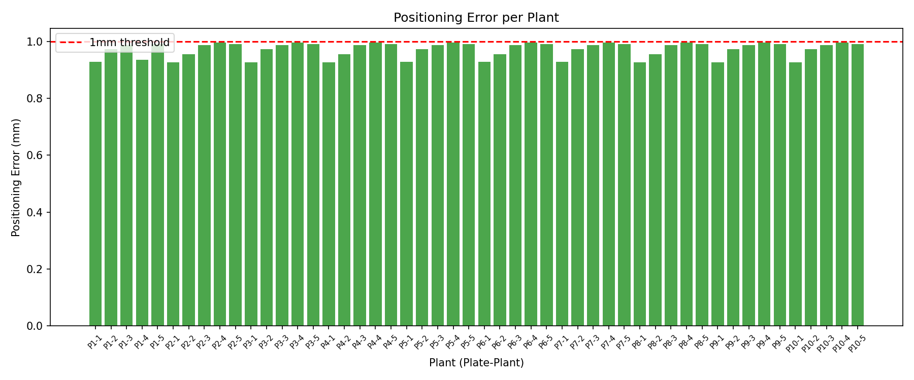
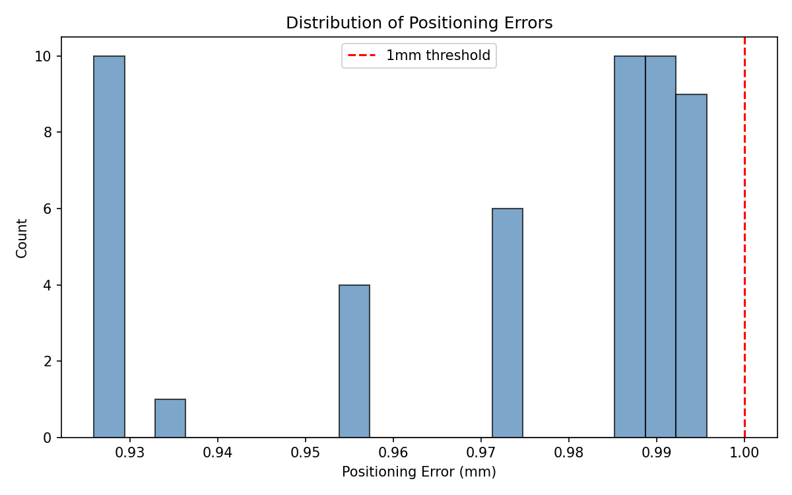
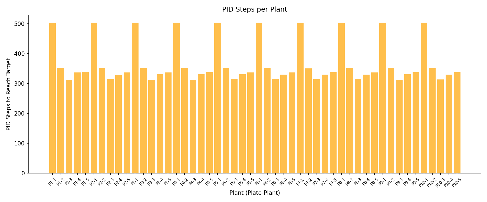
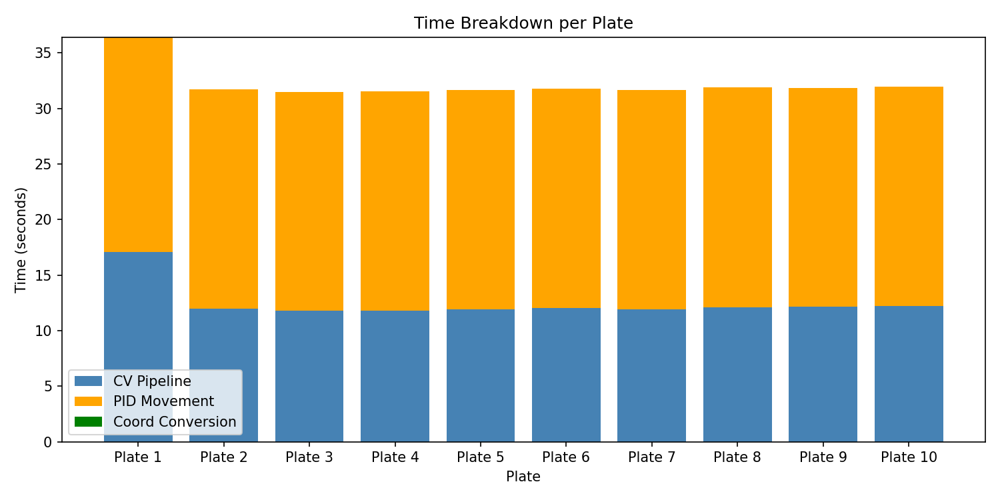
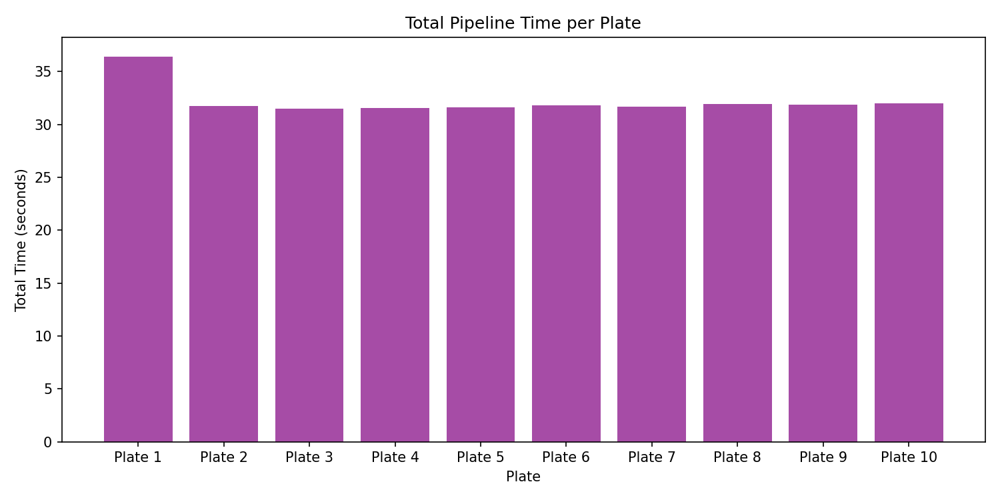
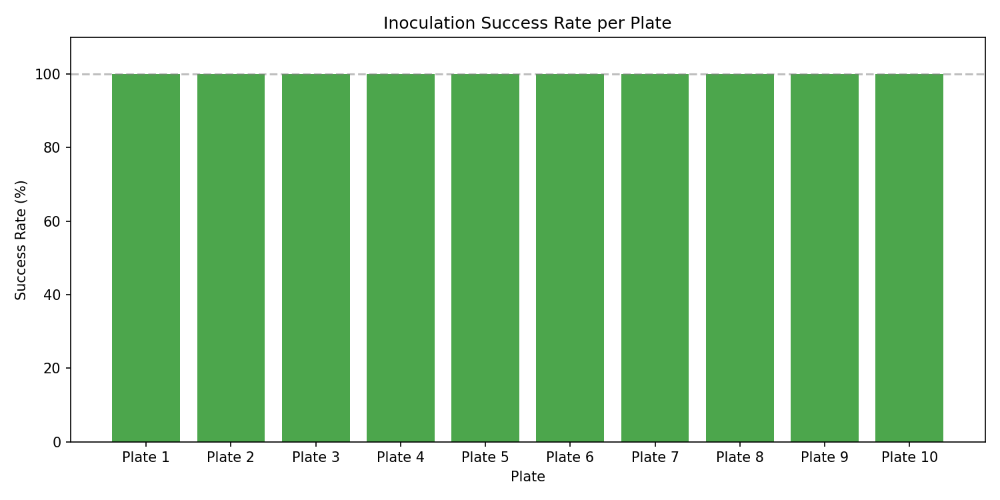

# Task 12: System Integration

**Student:** Ahmed (245226)  
**Controller Used:** PID (from Task 10)  
**Model Used:** Residual U-Net, 192px patches (from Task 5)

---

## What This Task Does

This task connects the computer vision pipeline (from Tasks 5–8) with the PID controller (from Task 10) into one complete system. The system can:

1. Look at a plate image from the simulation
2. Find where the root tips are in the image
3. Convert those pixel positions into robot coordinates
4. Move the robot pipette to each root tip
5. Drop inoculum on each root tip

Everything runs automatically — no human input needed after starting the script.

---

## How the System Works

```
┌──────────────┐    ┌───────────────┐    ┌──────────────────┐    ┌──────────────┐
│  Simulation   │    │  CV Pipeline   │    │  Coordinate      │    │  PID          │
│               │    │                │    │  Conversion      │    │  Controller   │
│  Gives us the │ -> │  Finds root    │ -> │  Converts pixel  │ -> │  Moves the    │
│  plate image  │    │  tip positions │    │  positions to    │    │  pipette and  │
│               │    │  in pixels     │    │  robot positions │    │  drops        │
│               │    │                │    │  in meters       │    │  inoculum     │
└──────────────┘    └───────────────┘    └──────────────────┘    └──────────────┘
```

### Step-by-step:

**Step 1 — Get the plate image**  
The simulation gives us an image of the current plate using `sim.get_plate_image()`. This is like a camera taking a photo of the plate.

**Step 2 — Find root tips (CV Pipeline)**  
The image goes through our full pipeline from Task 8:
- Crop the Petri dish from the image
- Improve contrast with CLAHE
- Pad the image so it fits our model's patch size (192×192)
- Run the U-Net model to predict which pixels are roots
- Clean up the prediction (remove noise, keep only root-like shapes)
- Split the mask into 5 separate plants
- Find each plant's skeleton and locate the root tip (bottommost point)

The output is a list of root tip positions in pixels, like: Plant 1 tip is at pixel (367, 937).

**Step 3 — Convert pixel coordinates to robot coordinates**  
The robot doesn't understand pixels — it needs positions in meters. We convert using these steps:

1. **Pixel to millimeters:** The plate is 150mm × 150mm. If the plate is 2800 pixels wide, then 1 pixel = 150/2800 = 0.054 mm.
2. **Swap axes:** In the image, plants are spread horizontally (pixel x), but in the robot they spread along the y-axis. And root depth (pixel y) maps to the robot x-axis.
3. **Add plate position:** The plate's top-left corner in the robot is at [0.10775, 0.062, 0.1195] meters. We add the mm-to-meters values to this origin.

```
conversion_factor = 150mm / plate_pixels

robot_x = plate_origin_x + (pixel_y × conversion_factor / 1000)
robot_y = plate_origin_y + (pixel_x × conversion_factor / 1000)
robot_z = 0.1195  (lowest height the pipette can reach)
```

**Plate origin values:**
- x = 0.10775 m
- y = 0.088 - 0.026 = 0.062 m (the 0.026 is a bug fix adjustment)
- z = 0.1195 m (pipette can't go lower than this in the simulation)

**Why z = 0.1195 instead of 0.057?**  
The plate surface is at z = 0.057m, but from Task 9 we know the pipette's lowest reachable height is z = 0.1195m. If we set z = 0.057, the pipette tries to go there but physically can't, causing a ~62mm error. Using z = 0.1195 fixes this.

**Step 4 — Move the robot and inoculate**  
For each root tip, three PID controllers (one for X, Y, and Z) send velocity commands to move the pipette to the target. When the pipette is within 1mm of the target, it drops the inoculum.

PID settings (from Task 10 tuning):
- Kp = 3.5
- Ki = 0.0
- Kd = 1.2
- Velocity clamp = ±0.3
- Stop when error < 0.001m (1mm)

---

## Files in This Folder

| File | What it does |
|---|---|
| `run_task12_all.py` | Main script — runs everything in order |
| `cv_pipeline.py` | All CV functions from Task 8 (crop, predict, clean, find tips) |
| `pixel_to_robot_mm.py` | Converts pixel positions to robot coordinates |
| `move_pid_to_tip.py` | Moves the pipette using PID and drops inoculum |
| `task_85.ipynb` | Original Task 8 pipeline notebook |
| `ahmed_245226_Residualunet_model_192px.h5` | Trained U-Net model (22MB) |
| `task12_inoculation.gif` | GIF showing autonomous inoculation |
| `task10_pid_controller/` | PID controller, simulation, robot files |

---

## Results

### Accuracy

| What | Value |
|---|---|
| Plates processed | 2 |
| Root tips detected | 10 |
| Successfully inoculated | 10 out of 10 |
| Mean positioning error | 0.000952 m (0.95 mm) |
| Max positioning error | 0.000998 m (0.99 mm) |
| All within 1mm? | Yes |

The integrated system has the same accuracy as the standalone PID controller from Task 10 (< 1mm error).

### Example Output

```
Plate 1 Plant 1: pixel (384, 551) → robot [0.1372, 0.0825, 0.1195] | err=0.000918m [OK]
Plate 1 Plant 3: pixel (1403, 552) → robot [0.1373, 0.1370, 0.1195] | err=0.000927m [OK]
Plate 1 Plant 5: pixel (2448, 514) → robot [0.1352, 0.1929, 0.1195] | err=0.000911m [OK]
```

### GIF

The file `task12_inoculation.gif` shows the robot automatically moving to each plant and dropping inoculum (red dots) across multiple plates.

---

## How to Run

### Install required packages

```bash
pip install pybullet tensorflow scikit-image networkx imageio opencv-python
```

### Run without GIF (fast, no display needed)

```bash
cd task12_13_integration_benchmarking
# Make sure render=False in run_task12_all.py
python run_task12_all.py
```

### Run with GIF (needs virtual display on headless server)

```bash
# Start virtual display
Xvfb :99 -screen 0 1280x960x24 -ac &
export DISPLAY=:99

# Make sure render=True, rgb_array=True in run_task12_all.py
python run_task12_all.py
# Output: task12_inoculation.gif
```

---

## Limitations

1. **Root detection is not perfect on all images.** The U-Net model was trained on specific images. On some plate images (from the simulator's texture folder), the model doesn't detect the full root length. This means the detected tip can be in the middle of the root instead of the very end. This is a model limitation from Task 5/8, not an integration issue.

2. **Simulator shows a different image than what the CV processes.** In the simulator version used, the plate texture (what you see on the robot) and the image returned by `get_plate_image()` can be different. In a real system, the camera would capture the actual plate, so this would not be an issue.

3. **Pipette cannot reach the plate surface.** The plate is at z = 0.057m but the pipette can only go down to z = 0.1195m. On the real OT-2, the pipette can reach the plate directly.

4. **Plate position is hardcoded.** The plate origin `[0.10775, 0.062, 0.1195]` is set as a variable that can be easily changed if the plate moves. On the real robot, this would need calibration.

5. **Assumes 5 plants per plate.** The pipeline splits the mask into 5 lanes. If a plate has fewer plants, some lanes will be empty (no tip detected), which is handled gracefully.

---

# Task 13: Performance Benchmarking and System Evaluation

## Benchmarking Approach

The full Task 12 pipeline was run on **10 specimen plates** (50 plants total) to measure accuracy, speed, and reliability. Each plate goes through the complete pipeline: image capture → CV detection → coordinate conversion → PID movement → inoculation.

The benchmarking script (`task13_benchmark.py`) records per-plant and per-plate metrics, saves results to CSV, and generates 6 visualization plots.

---

## Benchmark Results

### Overall Summary

| Metric | Value |
|---|---|
| Plates tested | 10 |
| Total tips detected | 50 |
| Total tips inoculated | 50 |
| Overall success rate | **100%** |

### Accuracy Metrics

| Metric | Value |
|---|---|
| Mean positioning error | 0.972 mm |
| Standard deviation | 0.026 mm |
| Min error | 0.926 mm |
| Max error | 0.996 mm |
| All within 1mm threshold | Yes  |

All 50 plants across 10 plates were inoculated within the 1mm accuracy threshold. The error is very consistent (std = 0.026mm), showing the PID controller is reliable and repeatable.

### Execution Time

| Metric | Value |
|---|---|
| Mean CV pipeline time per plate | 12.50 s |
| Mean PID movement time per plate | 19.70 s |
| Mean total time per plate | 32.20 s |
| Mean PID time per plant | 3.94 s |
| Mean PID steps per plant | 368 |
| Total benchmark time (10 plates) | 322.04 s (~5.4 min) |

The CV pipeline takes about **12.5 seconds** per plate (patch-based U-Net inference with 50% overlap). The PID controller takes about **3.9 seconds** per plant (average 368 steps to reach the target). Total time for one complete plate (5 plants) is about **32 seconds**.

### Time Breakdown

The time breakdown shows that the PID movement takes the majority of the time (~61%), while the CV pipeline takes ~39%. The coordinate conversion is almost instant.

| Step | Time | Percentage |
|---|---|---|
| CV Pipeline | 12.50 s | 39% |
| PID Movement (5 plants) | 19.70 s | 61% |
| Coordinate Conversion | <0.01 s | <1% |

Plate 1 is slightly slower (~36s) because of initial model warmup (TensorFlow/XLA compilation). All following plates are consistent at ~31-32s.

---

## Benchmark Visualizations

All plots are saved in `output/`:

1. **`error_per_plant.png`** — Bar chart showing positioning error for all 50 plants. All bars are green (under 1mm threshold).


3. **`error_distribution.png`** — Histogram of error values. Most errors cluster between 0.92-0.99mm, showing consistent PID performance.


5. **`steps_per_plant.png`** — PID steps needed per plant. First plant of each plate needs ~500 steps (longer travel from start position), while subsequent plants need ~310-350 steps (shorter distances between plants).


7. **`time_breakdown.png`** — Stacked bar chart showing CV time (blue) vs PID time (orange) per plate. Shows PID movement is the bottleneck.


9. **`total_time_per_plate.png`** — Total pipeline time per plate. Consistent ~32s except Plate 1 (~36s due to warmup).


11. **`success_rate.png`** — 100% success rate across all 10 plates.


---

## Improvement

### 1. Improve Root Tip Detection
The U-Net model does not always detect the full root length, especially on images outside the training distribution. The detected tip can be at an intermediate position rather than the true root tip. **Recommendation:** Retrain the model with more diverse images and use data augmentation (rotation, brightness, contrast) to improve generalization.

### 2. Reduce PID Settling Time
The PID controller takes ~368 steps on average per plant. The first plant of each plate takes ~500 steps because the pipette starts far away. **Recommendation:** Increase Kp slightly (e.g., from 3.5 to 4.0) or add a small Ki term (e.g., 0.01) to speed up convergence. Also consider adding a "fast approach" mode that uses higher velocity for large distances and switches to fine PID control when close.

### 3. Speed Up CV Pipeline
The patch-based inference with 50% overlap takes 12.5 seconds per plate. **Recommendation:** Use larger batch sizes (currently batch_size=1), reduce overlap from 50% to 25%, or use a lighter model architecture. GPU batch processing could reduce CV time by 3-5x.

### 4. Add Plate Position Calibration
The coordinate transformation uses hardcoded plate positions. **Recommendation:** Implement a calibration procedure using known reference points on the plate (e.g., corner markers) to automatically determine the pixel-to-robot mapping for each plate.

### 5. Handle Variable Plant Counts
The pipeline assumes 5 plants per plate. Some plates may have fewer detectable plants. **Recommendation:** The system already handles this (skips empty slots), but adding a confidence score per detection would help identify uncertain tips.

### 6. Real-time Feedback
Currently the system runs open-loop — it detects tips, converts coordinates, and moves without checking if the drop actually landed correctly. **Recommendation:** Add a verification step that captures an image after inoculation and checks if the red droplet is at the expected location.

---

## Benchmark Files

| File | What it does |
|---|---|
| `task13_benchmark.py` | Runs the full benchmark (10 plates, timing, accuracy) |
| `output/benchmark_plants.csv` | Per-plant results (error, steps, time) |
| `output/benchmark_plates.csv` | Per-plate summary (timing, success rate) |
| `output/error_per_plant.png` | Error bar chart |
| `output/error_distribution.png` | Error histogram |
| `output/steps_per_plant.png` | PID steps chart |
| `output/time_breakdown.png` | Time breakdown stacked bar |
| `output/total_time_per_plate.png` | Total time per plate |
| `output/success_rate.png` | Success rate per plate |

---

## What I Learned

- How to connect a computer vision pipeline with a robotic controller
- How to convert between different coordinate systems (pixel → mm → robot)
- The importance of understanding axis mapping between image space and robot space
- How simulation limitations (like unreachable z-heights) affect system design
- How to use virtual displays (Xvfb) for headless GIF recording
- How to benchmark a complete system and identify bottlenecks
- The importance of measuring both accuracy and speed for real-world deployment
