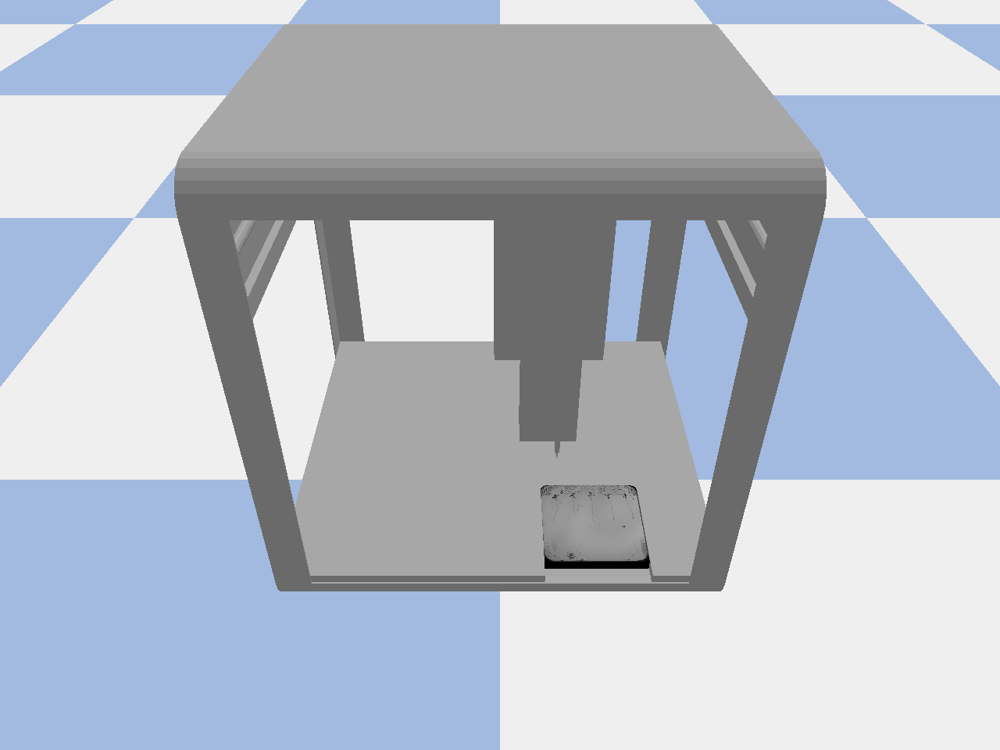
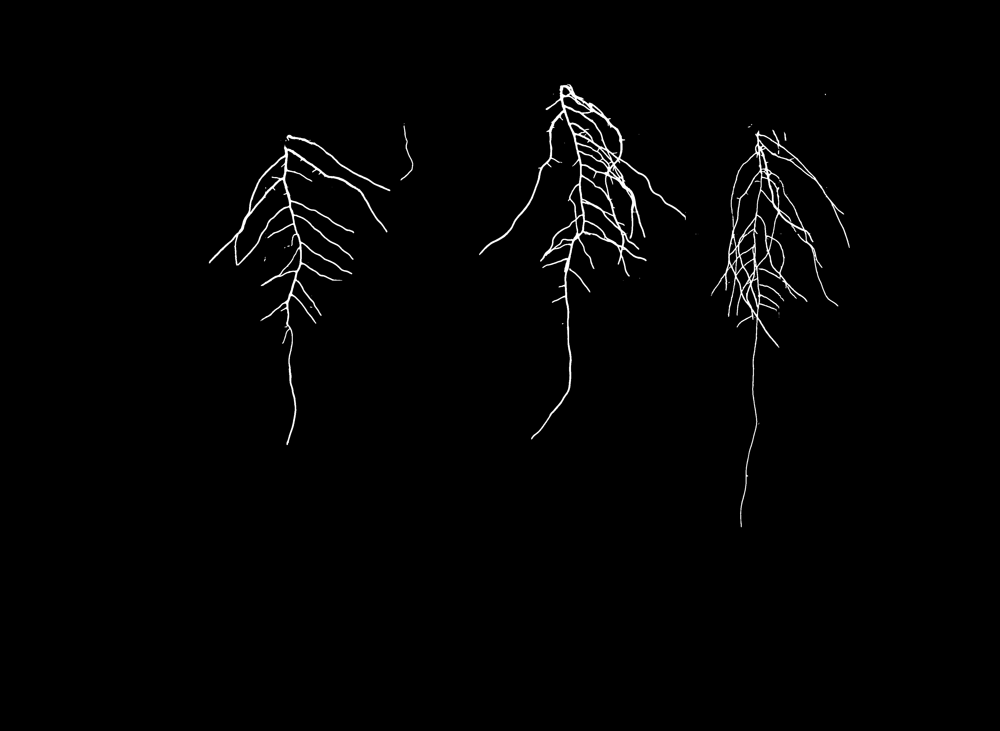
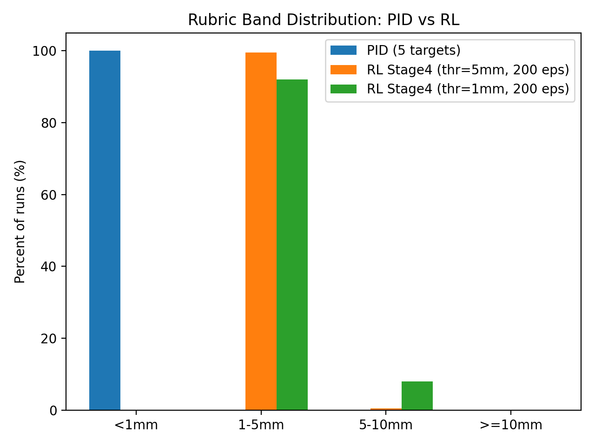

# Plant Phenotyping & Robotics Pipeline

An end-to-end system that **finds plant root tips in Petri-dish images and drives a robot to inoculate them automatically**.
Built for a plant phenotyping use case from NPEC (Netherlands Plant Eco-phenotyping Centre), using a simulated Opentrons OT-2 lab robot.



**Highlights**

- **50 / 50 plants inoculated** across 10 plates, mean positioning error **0.97 mm** (all within the 1 mm target)
- U-Net and Residual U-Net root segmentation trained from scratch (TensorFlow / Keras)
- Hand-tuned **PID controller** reaching sub-millimetre accuracy (5/5 targets < 1 mm)
- **Reinforcement learning controller** (PPO, Stable-Baselines3) with a custom Gymnasium environment, benchmarked against PID
- Root-length prediction Kaggle competition: final private-leaderboard score **9.359**

**Tech stack:** Python · TensorFlow/Keras · OpenCV · scikit-image · NetworkX · PyBullet · Gymnasium · Stable-Baselines3 · ClearML · Matplotlib

---

## How it works

```
Plate image ──► Computer vision ──► Pixel → robot ──► PID controller ──► Inoculate
                (U-Net + post-       coordinate        (3-axis, < 1 mm)
                 processing,         conversion
                 root-tip search)
```

1. **Detect the Petri dish** with classical CV (thresholding + largest contour) and crop it.
2. **Segment the roots** with a Residual U-Net on 192 px patches, then clean the mask.
3. **Split the mask into the 5 plants**, skeletonise each root and find its tip with graph search (NetworkX).
4. **Convert pixel coordinates to robot coordinates** (pixel → mm → metres in the robot frame).
5. **Move the pipette** to each tip with a PID controller and drop the inoculum.

---

## Results

### Computer vision

| Root segmentation (U-Net prediction) |
|---|
|  |

### Controllers: PID vs. reinforcement learning

| Controller | Mean final error | Runs < 1 mm |
|---|---|---|
| **PID** (Kp 3.5, Ki 0, Kd 1.2) | **0.93 mm** | 100 % |
| **RL** (PPO, 200 episodes) | 3.5 – 4.9 mm | 0 % (92–99.5 % in the 1–5 mm band) |

The RL agent learns to reach every target reliably, but PID stays about 4× more precise. For a task with a hard 1 mm tolerance, the simpler controller wins.

| Average final error | Accuracy bands |
|---|---|
|  |  |

### Full-system benchmark (10 plates, 50 plants)

| Metric | Value |
|---|---|
| Success rate | **100 %** (50 / 50) |
| Mean / max positioning error | 0.972 mm / 0.996 mm (std 0.026 mm) |
| Time per plate | ~32 s (CV 12.5 s, robot movement 19.7 s) |


---

## Repository structure

| Folder | What's inside |
|---|---|
| [`1-computer-vision/`](1-computer-vision/) | Notebooks: Petri-dish detection, instance segmentation, U-Net and Residual U-Net training/inference, Kaggle root-length pipeline. Trained models in `models/`. |
| [`2-robot-workspace/`](2-robot-workspace/) | Mapping the OT-2's reachable 3D workspace with velocity control. |
| [`3-pid-controller/`](3-pid-controller/) | 3-axis PID controller, tuning experiments and response plots. |
| [`4-rl-controller/`](4-rl-controller/) | Custom Gymnasium wrapper, PPO training/testing, trained weights, PID vs. RL comparison. |
| [`5-integration-benchmark/`](5-integration-benchmark/) | The full CV + robot system and the 10-plate benchmark. |
| [`docs/`](docs/) | Final presentation (PDF). |

Each folder has its own README with details, design decisions and how to run it.

---

## Getting started

```bash
git clone https://github.com/AhmedAlezabi1/plant-phenotyping-robotics.git
cd plant-phenotyping-robotics
python -m venv .venv && .venv\Scripts\activate      # Python 3.10
pip install -r requirements.txt
```

Then follow the README in the folder you want to run. For example, to evaluate the trained RL agent:

```bash
python 4-rl-controller/training/RL_testing_code.py --model_path 4-rl-controller/training/ppo_ot2_finals4.zip --episodes 200
```

> **Note:** the robot scripts need the OT-2 PyBullet simulation (`sim_class.py`, URDFs, meshes and textures), which was provided by the course. The meshes/textures and the plant image dataset are not included in this repository.

---

## What I learned

- Training segmentation models from scratch and handling the gap between training data and new images
- Turning a model prediction into a physical action: coordinate systems, axis mapping and calibration
- Designing reward functions for RL, and recognising when a classical controller is the better tool
- Benchmarking a complete system for accuracy **and** speed to find the real bottleneck

---

## Acknowledgements

Built during Year 2, Block B of the Applied Data Science & AI programme at Breda University of Applied Sciences.
The OT-2 digital twin and the plant image data were provided by the course and by NPEC.

**Author:** Ahmed Ali Alezabi · [GitHub](https://github.com/AhmedAlezabi1)
